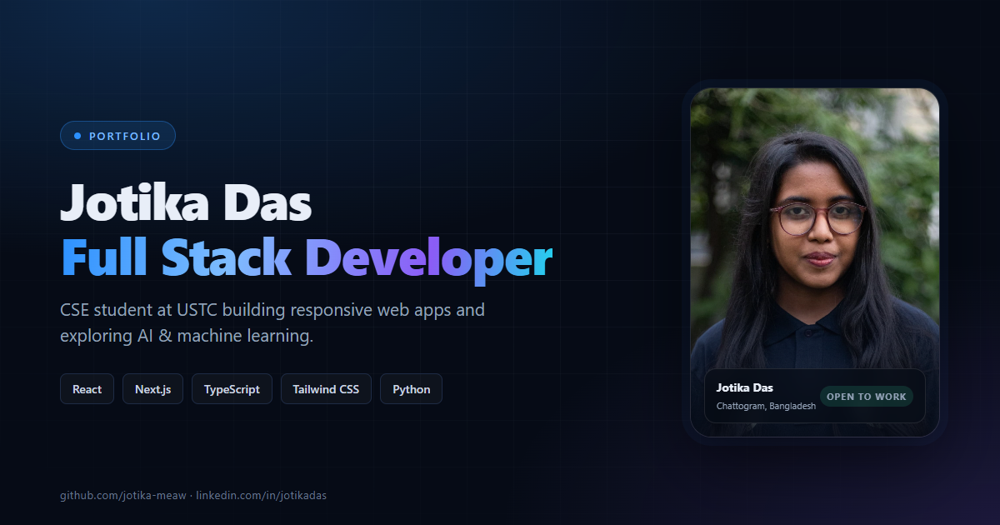

# Jotika Das — Portfolio

A dark, responsive personal portfolio for **Jotika Das**, a Full Stack Developer and Computer Science & Engineering undergraduate at the University of Science and Technology Chittagong (USTC).

**Live site:** [jotika-portfolio.vercel.app](https://jotika-portfolio.vercel.app)



## Highlights

- Responsive single-page portfolio with anchor navigation, scroll spy, and a full-screen mobile menu
- Hero banner with professional photo, availability status, one-click resume download, and social links
- About section covering the development journey, AI/ML interests, and community work beyond code
- Categorized, animated skill bars across frontend, backend, AI/ML, and tools
- Education (B.Sc. in CSE at USTC) and a leadership / experience timeline
- Four project case studies with tech stack, description, live link, GitHub repository, challenges, and future plans
- FAQ accordion using native accessible `<details>` elements
- Contact section with email, phone, location, social links, and a mailto-powered message form
- Downloadable one-page resume (`/resume.pdf`) plus a print-friendly resume page (`/resume`)
- SEO metadata, Open Graph image, custom favicon, and a custom 404 page
- Reduced-motion support and keyboard-friendly interactions

## Tech stack

| Layer | Tools |
| --- | --- |
| Framework | Next.js 16 (App Router, Cache Components) |
| UI | React 19, TypeScript, Tailwind CSS v4 |
| Animation | Framer Motion |
| Icons | lucide-react, react-icons |
| Deployment | Vercel |

## Getting started

Requirements: Node.js 20.9+ and npm.

```bash
npm install
npm run dev
```

Open [http://localhost:3000](http://localhost:3000).

### Available scripts

| Command | Description |
| --- | --- |
| `npm run dev` | Start the development server |
| `npm run build` | Create an optimized production build |
| `npm run start` | Serve the production build |
| `npm run lint` | Run ESLint |

## Project structure

```text
src/
├─ app/
│  ├─ page.tsx                 # Homepage composition
│  ├─ layout.tsx               # Fonts, metadata, viewport
│  ├─ globals.css              # Tailwind theme tokens and global styles
│  ├─ not-found.tsx            # Custom 404
│  ├─ icon.svg                 # Favicon
│  ├─ resume/page.tsx          # Print-optimized resume
│  └─ projects/[slug]/page.tsx # Project case-study pages
├─ components/                 # Page sections and shared UI
├─ data/                       # Profile, projects, skills, education, experience
└─ lib/techIcons.tsx           # Tech name → icon mapping

public/
├─ images/profile.jpg          # Professional portrait
├─ images/projects/            # Project cover screenshots
├─ resume.pdf                  # Downloadable one-page resume
└─ og-image.png                # Social sharing image
```

All site content is data-driven. Update the files in `src/data/` to change the profile, projects, skills, education, or experience without touching the layout.

## Deployment

The site is deployed on Vercel. To deploy your own copy:

```bash
npm i -g vercel
vercel --prod
```

Optionally set `NEXT_PUBLIC_SITE_URL` to the production URL so canonical links, Open Graph URLs, and metadata resolve to the correct domain.

## Contact

- Email: [jotikadas57@gmail.com](mailto:jotikadas57@gmail.com)
- LinkedIn: [linkedin.com/in/jotikadas](https://www.linkedin.com/in/jotikadas)
- GitHub: [github.com/jotika-meaw](https://github.com/jotika-meaw)

---

© 2026 Jotika Das. All rights reserved.
